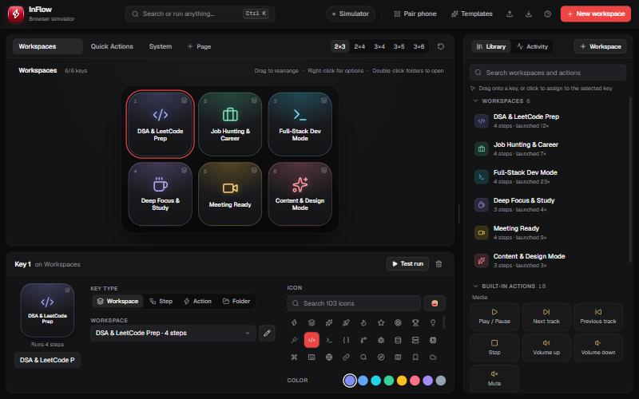
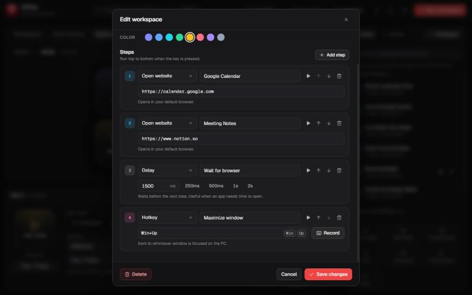
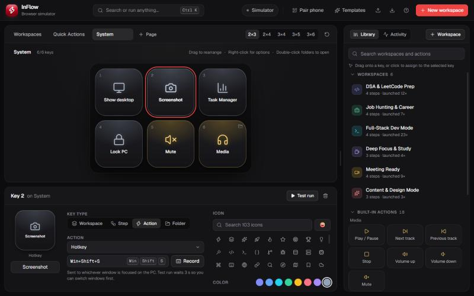
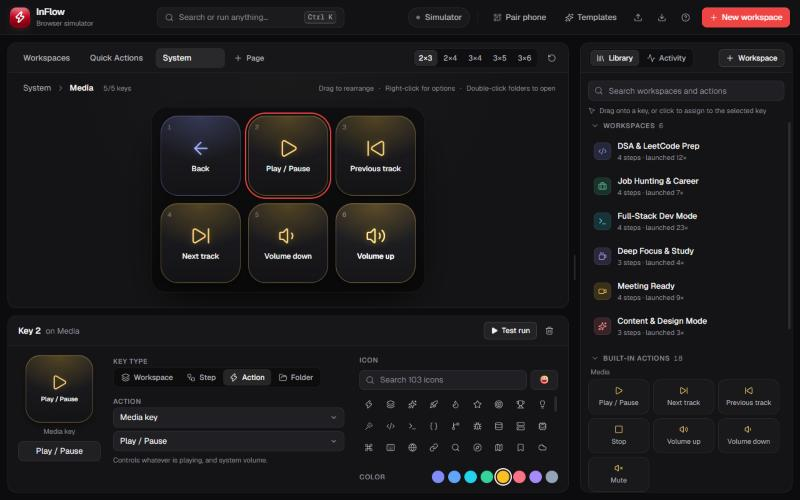
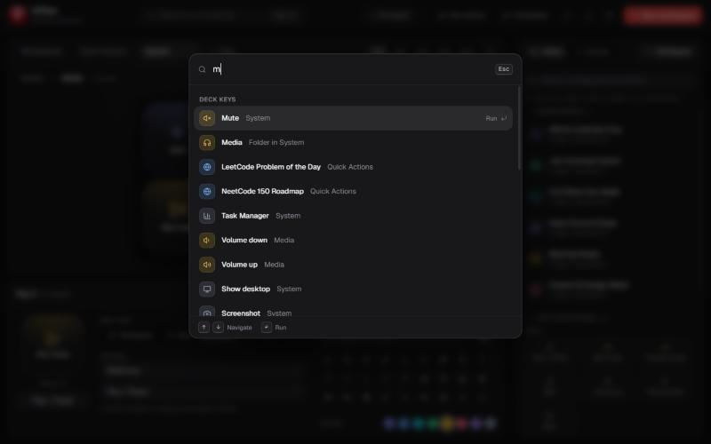
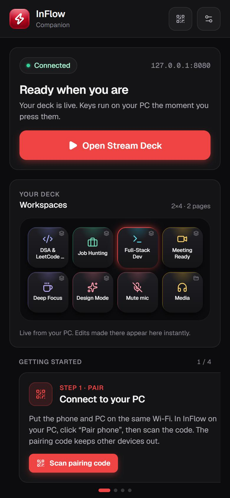
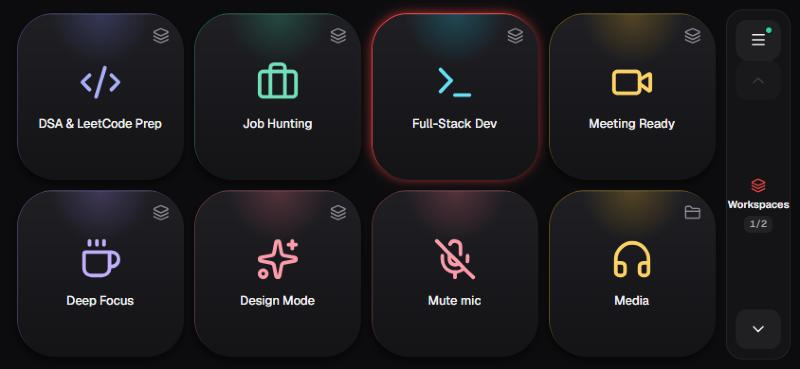
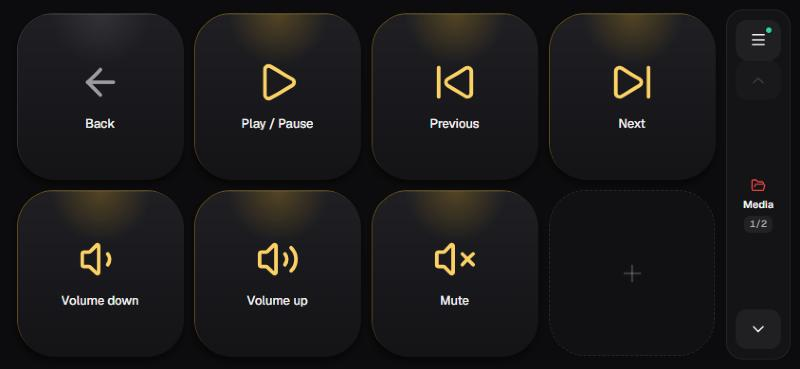
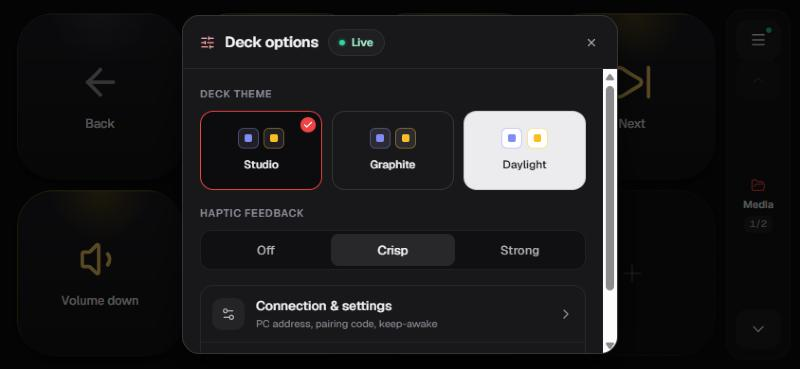
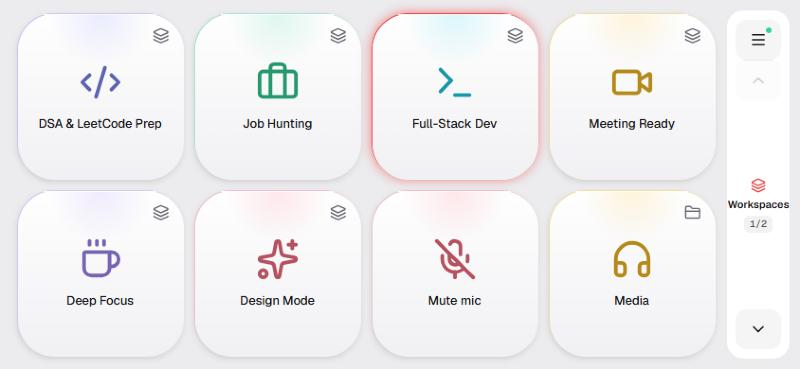

<div align="center">


# InFlow

**Turn your phone into a Stream Deck for your Windows PC.**

Design a grid of keys on the desktop, pair your phone once, and every tap runs on your PC:<br/>
whole workspaces, apps, hotkeys, typed snippets, media keys or shell commands.

[**Website**](https://inflow-deck.vercel.app/) · [**Download**](https://github.com/RizwanMolla/inflow/releases/latest) · [Features](#-the-windows-app) · [Mobile app](#-the-mobile-companion) · [How it works](#-how-it-works)

Tauri v2 · Rust · React 19 · TypeScript · Tailwind CSS v4 · React Native (Expo)

<br/>



</div>

---

## 🖥️ The Windows app

The desktop app is the **deck studio**: you design every key here, and it runs the local server your phone connects to.

### Workspaces: one key, a whole setup

A workspace is a multi-action key. Press it and InFlow opens your sites, folders, files and apps in order, waits where you tell it to, then sends a shortcut. Pick from ready-made templates or build your own.



**9 step types:** Website · App · Folder · File · Run command · Hotkey · Type text · Media key · Delay

### Single-action keys, like a real Stream Deck

Drag built-in actions from the library onto any key: media controls, Show desktop, Screenshot, Task Manager, Lock PC, or your own hotkey. The **Record** button captures a shortcut as you press it.



### Folders

Nest a page of keys behind a folder key. Every folder keeps its first key as **Back**, exactly like a Stream Deck, and the breadcrumb shows where you are.



### Command bar

Press `Ctrl K` anywhere to launch a workspace, run any key, or jump into a folder without touching the mouse.



**Also in the studio**
- Drag keys to rearrange; right-click for copy, paste, duplicate and clear; arrow keys and `Delete` work too
- Five grid sizes, from 2×3 to 3×6, and multiple pages
- Searchable icon library (100+ icons, or any emoji) and eight accent colors
- Activity log of every key press, with its source and result
- Runs in the **system tray**, so your phone keeps working with the window closed

---

## 📱 The mobile companion

The phone app renders the exact deck you designed, using the same key faces and design tokens as the desktop.

<table>
  <tr>
    <td width="34%" valign="top">
      
    </td>
    <td valign="top">
      
      <br/><br/>
      
    </td>
  </tr>
</table>

- **Live connection** with a preview of your deck; the running workspace glows red
- **Full-screen landscape deck** with page switching and folder navigation
- **Feedback both ways:** each key flashes green or red with the result reported by the PC
- **Haptics tuned per gesture:** one crisp click on touch-down, light ticks for navigation, a distinct pattern for failures. On Android it uses the system haptic engine instead of the buzzy vibration motor; choose *Off*, *Crisp* or *Strong*
- **QR pairing** in seconds, or manual entry of address + pairing code

<table>
  <tr>
    <td width="50%"></td>
    <td width="50%"></td>
  </tr>
  <tr>
    <td align="center"><sub>Deck options: themes and haptic strength</sub></td>
    <td align="center"><sub>Daylight theme</sub></td>
  </tr>
</table>

---

## ⚙️ How it works

```
┌──────────────────────────────── InFlow Desktop (Tauri) ────────────────────────────────┐
│                                                                                       │
│  React UI (deck studio)                         Rust backend                          │
│  ├─ DeckCanvas / KeyInspector / Library  ◄────► ├─ actions.rs  hotkeys, text, media   │
│  ├─ LauncherService (runs workspaces)    invoke │               keys (enigo), commands│
│  └─ deckOps (pure deck editing helpers)  events ├─ server.rs   Axum HTTP + WebSocket  │
│                                                 │               token auth, mDNS      │
│                                                 └─ lib.rs      commands, system tray  │
└───────────────────────────────────────────────────────────────┬───────────────────────┘
                                                                │  Wi-Fi · port 8080
                                                                │  Bearer / ?token=
                                                                ▼
                                          ┌──────────────── InFlow Companion (Expo) ─────┐
                                          │  Landscape deck · folders · haptics          │
                                          │  QR pairing · result flashes · keep-awake    │
                                          └──────────────────────────────────────────────┘
```

**A key press, end to end**

1. The phone sends `TRIGGER_LAUNCH { slotId, pageId }` over the WebSocket.
2. The Rust server checks the pairing token and emits a `remote-launch-trigger` event to the UI.
3. The UI looks the key up **in its own deck** (the phone never decides what runs), executes it, and flashes the key.
4. The UI calls `report_launch_result`; the server broadcasts `LAUNCH_RESULT` and the phone key flashes green or red.

**Pairing and security.** The server only accepts devices holding the PC's 8-character pairing code, which is embedded in the QR code. Everything else gets `401`. **Reset pairing code** disconnects every phone immediately. Nothing leaves your network: there is no account and no cloud. If port 8080 is busy, the server falls back to 8081–8089, and the QR code always carries the real port.

<details>
<summary><b>Server API</b></summary>

| Endpoint | Auth | Purpose |
|---|---|---|
| `GET /api/status` | public | Reachability probe; reports `authorized` for the supplied token |
| `GET /api/deck` | token | Current deck layout |
| `POST /api/launch` | token | `{ slot_id, page_id }` or legacy `{ workspace_id, action_id }` |
| `GET /ws?token=…` | token | Live sync: `CLIENT_CONNECTED`, `DECK_CONFIG_UPDATE`, `ACTIVE_WORKSPACE_CHANGE`, `LAUNCH_RESULT`, `PAIRING_REVOKED`, `PONG` |

</details>

<details>
<summary><b>Desktop keyboard shortcuts</b></summary>

| Shortcut | Action |
|---|---|
| `Ctrl K` | Command bar |
| `← ↑ → ↓` | Move between keys |
| `Enter` | Test-run the key / open the folder |
| `Delete` | Clear the key |
| `Ctrl C` / `Ctrl V` / `Ctrl D` | Copy, paste, duplicate |
| `Esc` | Leave the current folder |
| Double-click a page tab | Rename it |

Hotkey and Type-text keys wait 3 seconds when test-run from the desktop, so you can focus the target window first.

</details>

---

## 📦 Download

Grab the Windows installer and the Android APK from the [**latest release**](https://github.com/RizwanMolla/inflow/releases/latest). Install InFlow on your PC, open **Pair phone**, and scan the code with the companion app. Both devices must be on the same Wi-Fi.

---

## 🛠️ Development

**Tech stack**
- **Desktop:** [Tauri v2](https://v2.tauri.app/), React 19, TypeScript, Tailwind CSS v4, Geist & Geist Mono (bundled, works offline)
- **Backend:** [Axum](https://github.com/tokio-rs/axum), [Tokio](https://tokio.rs/), [enigo](https://crates.io/crates/enigo) (input simulation), [mdns-sd](https://crates.io/crates/mdns-sd), tower-http
- **Mobile:** [Expo](https://expo.dev/) / React Native, `expo-haptics`, `expo-camera`, `expo-keep-awake`, `react-native-svg`, Geist via `@expo-google-fonts`. Design tokens in `mobile/src/ui/tokens.ts` mirror `src/index.css`
- **Website:** React, Vite and GSAP (`website/`)

```bash
# Desktop app (starts the deck server on your LAN)
npm install
npm run tauri dev

# Browser simulator (UI only, no server or native actions)
npm run dev

# Mobile companion
npm run mobile:start

# Mobile UI in a browser (layout preview; no camera or haptics)
npm --prefix mobile run web

# Android APK (sideloadable release build)
cd mobile && eas build -p android --profile preview
```

**Showcase website.** Live at [inflow-deck.vercel.app](https://inflow-deck.vercel.app/). Links live in `website/src/config.ts`; they open the latest GitHub release until you point them at the uploaded installer/APK.

```bash
cd website
npm install
npm run dev      # http://localhost:5180
npm run build    # static site in website/dist (works on GitHub Pages or any host)
```

**Checks**

```bash
npm run build                      # type-check + production bundle
npm run lint                       # oxlint
cd src-tauri && cargo test         # hotkey parsing & pairing token tests
```

---

## 📄 License & Terms

Copyright © 2026 Rizwan Molla. All rights reserved.

This is a personal project published for portfolio demonstration purposes only. The source code, assets, and design may not be copied, distributed, modified, or used for commercial purposes without explicit permission.
